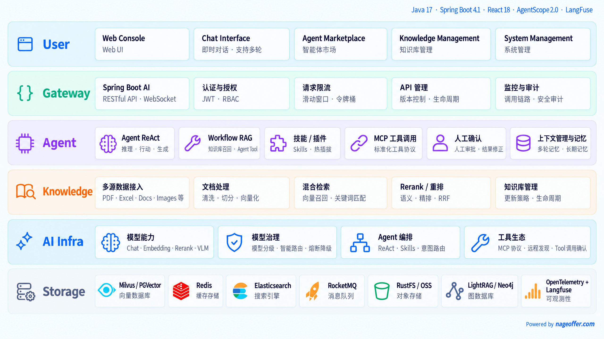
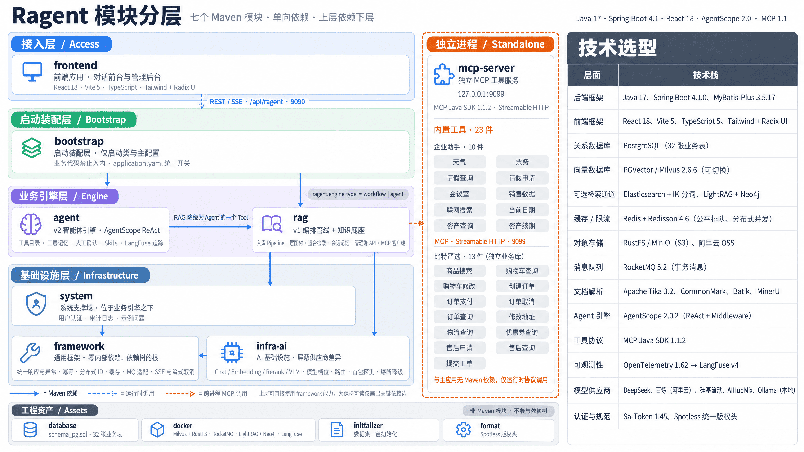
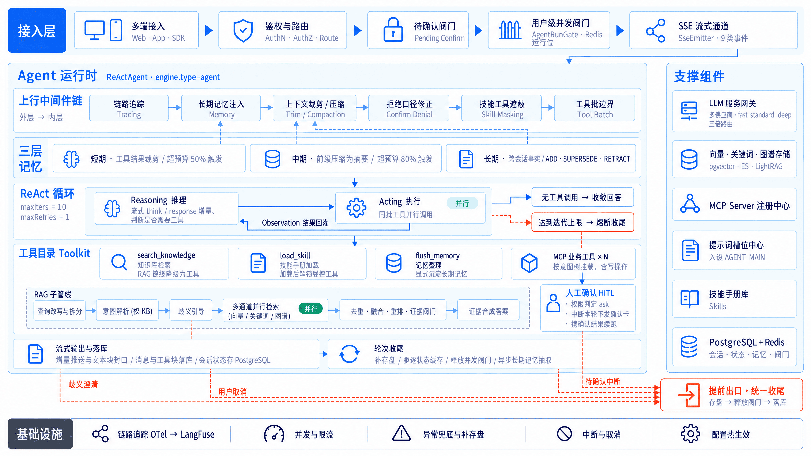
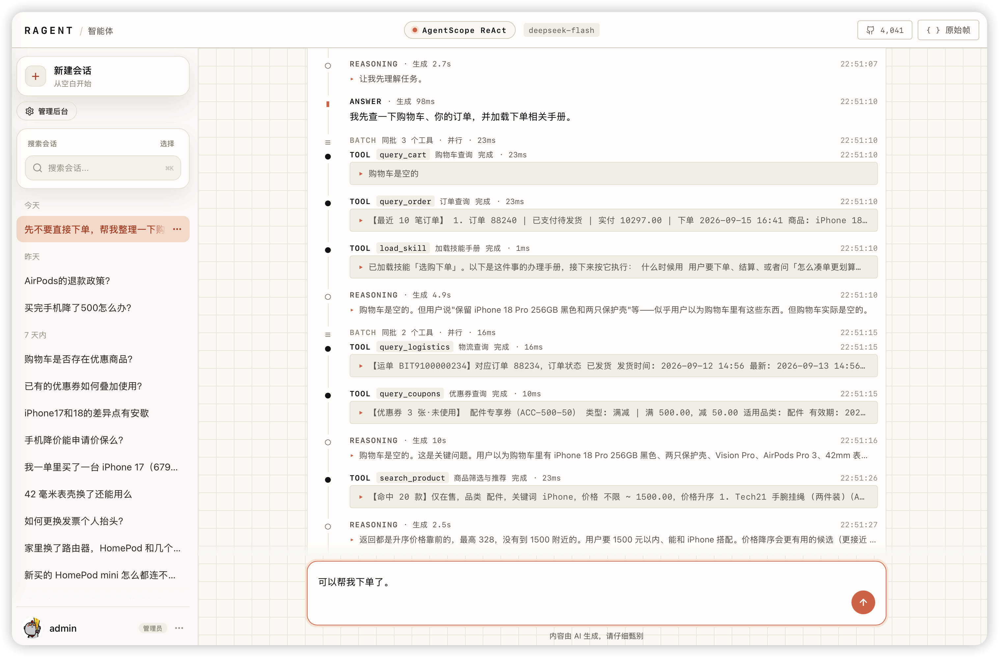
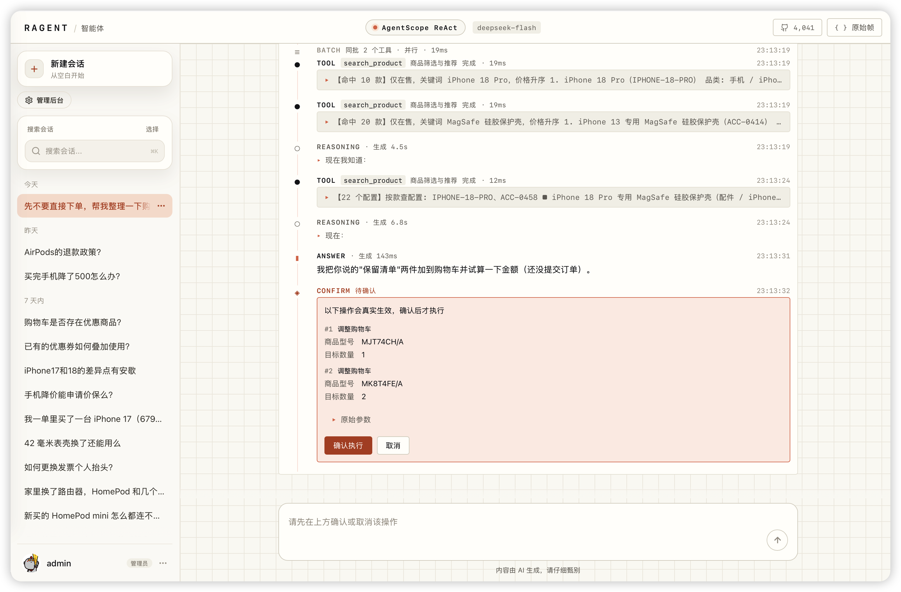
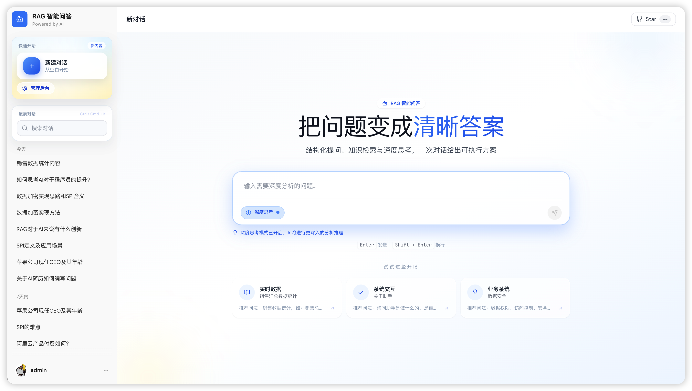
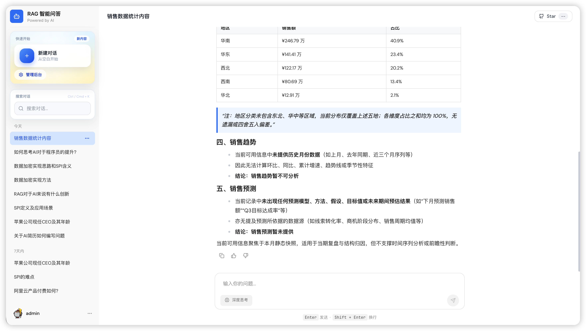
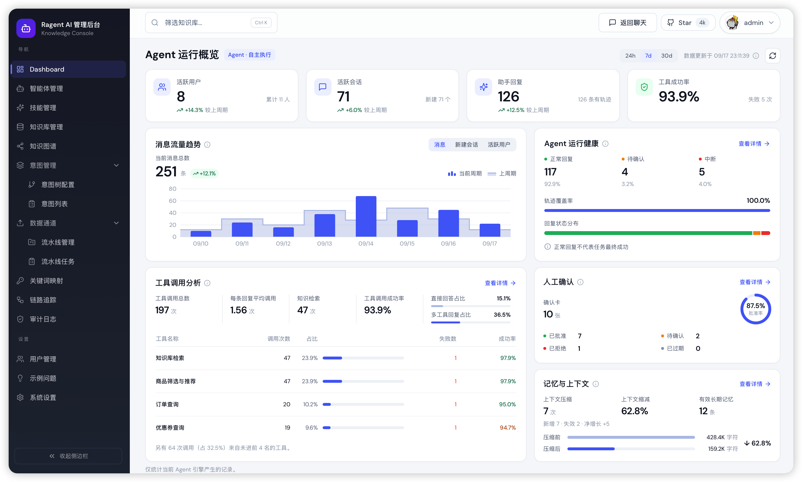
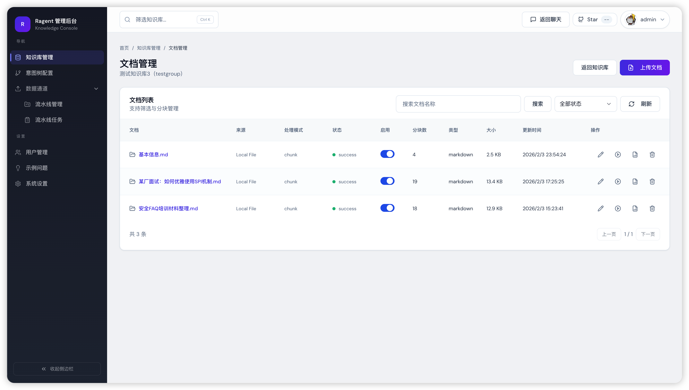
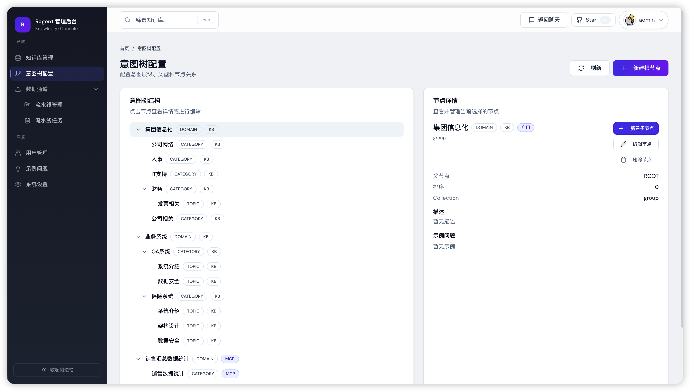

<p align="center">
  <h1>TsFlow</h1>
  <p><strong>一个生产级的 Java Agentic RAG 应用平台</strong></p>
</p>

<p align="center">
  <a href="https://github.com/sper-51/TsFlow/stargazers"></a>&nbsp;
  <a href="https://github.com/sper-51/TsFlow/network/members"></a>&nbsp;
  <a href="./LICENSE"></a>&nbsp;
  &nbsp;
  
</p>

## 🚀 TsFlow 是什么

TsFlow 是我独立开发的一个面向 Agentic RAG 演进的生产级 Java AI 应用平台，覆盖从文档入库到智能问答的完整链路。它不是调一次 API 的 Demo，而是一套经过真实场景锤炼的工程实践：

- **混合检索**：向量、关键词、知识图谱、联网搜索并行召回，支持去重、RRF 融合与 Rerank。
- **问题理解**：查询词映射、问题重写与拆分、树形意图识别和多知识库路由。
- **模型与工具**：模型档位、首包探测、熔断降级，以及基于 MCP 的工具发现与调用。
- **会话记忆**：最近 N 轮消息结合持久化摘要，控制 Token 成本并保留关键上下文。
- **流量保护**：Redis 公平排队与分布式并发控制，避免突发请求压垮模型服务。
- **知识闭环**：可编排入库 Pipeline、远程刷新、回答溯源、用户反馈、全链路 Trace 和管理后台。



## 🏗️ 核心设计

采用前后端分离的模块化单体架构，后端按职责分为七个 Maven 模块：

| 模块 | 职责 |
|:---|:---|
| `infra-ai` | Chat / Embedding / Rerank / VLM 模型客户端、模型档位、路由、首包探测、健康状态与降级 |
| `system` | 用户认证与审计日志，位于各业务引擎之下的系统支撑域 |
| `rag` | RAG 问答、知识库、入库 Pipeline、意图树、检索、会话及管理端 API |
| `agent` | ReAct 执行引擎，接入知识检索与 MCP 工具，支持技能、记忆和人工确认 |
| `bootstrap` | 启动装配层，仅含启动类与主配置 |
| `framework` | 统一响应与异常、幂等、分布式 ID、MQ 适配、SSE 与跨节点流式取消等基础能力 |
| `mcp-server` | 基于 MCP Java SDK 的独立工具示例服务，内置天气、票务、销售与联网搜索示例 |

这个分层把业务编排、AI 供应商差异和通用基础设施隔离开：切换模型、向量库或对象存储时，核心问答流程不需要跟着重写。



一次提问在服务里怎么走，v1 和 v2 是两套路子：

- **v1 是 Workflow 编排**，路径写死在代码里：问题重写、意图识别、多路召回、组装生成，一步接一步走完。
- **v2 是 Agentic 架构**，路径由模型自己定：知识检索、MCP 工具和 Skills 技能都变成它手里的工具，查不查、查几次、查完接着干什么，在 ReAct 循环里边推理边决定。

两套并存，不是谁替代谁。问答类知识助手需求走 v1 更快也更可控，要规划、要动手操作的场景才交给 v2。

> 下图是 v2 的核心流程，实际代码中的逻辑比图上更复杂。



## ✨ 工程亮点

### 设计模式实战

项目里的设计模式，每个都对着一个具体问题：

| 设计方式 | 业务场景 | 解决的问题 |
|:---|:---|:---|
| 策略 | 检索通道、结果后处理、文档来源 | 不同实现可独立替换 |
| 工厂 | 意图树、分块策略、流式回调创建 | 集中复杂对象的创建逻辑 |
| 模板方法 | 并行检索、模型请求 | 固定通用流程，仅开放差异步骤 |
| 注册表 | 意图节点管理 | 统一注册和查找配置 |
| 装饰器 | 向量写入时同步关键词和图谱索引 | 在不修改主流程的前提下增强能力 |
| 责任链 | 检索后处理、模型故障降级 | 按顺序组合处理步骤 |
| 中间件 | Agent 记忆注入、上下文压缩、技能遮蔽、工具批处理 | 不改执行引擎就能插拔能力 |
| 适配器 | 多家模型方言、Agent MCP 业务规则、MQ 客户端 | 屏蔽外部接口差异 |
| 状态机 | 远程文档定时刷新 | 约束状态流转，挡住非法跳转 |
| 事件回调 | 模型流式响应、首包探测、SSE 输出 | 解耦事件生产与消费 |
| AOP | 链路追踪、幂等、审计日志 | 将横切逻辑与业务解耦 |

### 可扩展性

核心能力通过接口、注册表和配置隔离，新增实现可以复用现有编排、容错、日志和管理能力：

| 扩展维度 | 如何接入 |
|:---|:---|
| 模型 | 实现 `ChatClient` / `EmbeddingClient` / `RerankClient`，加入模型候选配置，即可进入档位路由，复用首包探测、健康检查和熔断降级 |
| 存储 | 实现向量存取或 `ObjectStorageClient`，通过配置选择实现，知识入库与问答主流程保持不变 |
| 检索 | 实现 `SearchChannel` 或后处理器，注册为 Spring Bean 并设置顺序，新通道参与并行召回 |
| 入库 | 实现 `IngestionNode` 或 `DocumentFetcher`，新处理步骤或文档来源进入 Pipeline |
| Agent | 新建人设与技能手册，或注册新的中间件，复用 ReAct 循环、记忆与人工确认 |
| MCP | 暴露 MCP 工具规范，在 `agent.mcp.servers` 配置外部 MCP Server |

### 生产级特性

| 特性 | 说明 |
|:---|:---|
| **流量保护** | Redis ZSET 公平排队，结合 Lua 原子抢占、过期信号量和 Pub/Sub 唤醒 |
| **模型容错** | 多候选模型自动切换，首包超时、空响应或异常时触发降级；三态熔断隔离故障节点 |
| **检索稳定性** | 多通道并行检索，单通道失败不影响主链；按召回、Rerank、TopK 分层控制检索规模 |
| **数据一致性** | RocketMQ 事务消息保障分块可靠执行；支持幂等，远程刷新使用分布式锁和状态机 |
| **可观测与审计** | 记录 Trace Run / Node 的耗时、输入输出和异常；管理端提供趋势、详情及配置变更 Diff |
| **流式体验** | SSE 分事件输出思考、正文、来源和推荐问题；支持全局超时及客户端断开取消 |
| **会话与证据** | 消息持久化和摘要控制上下文；保存引用来源，支持原文预览、追问和反馈 |
| **Agent 执行保障** | 上下文按水位裁剪与压缩，长期记忆跨会话沉淀；写操作可配置人工确认，支持执行中断 |
| **安全基础** | Sa-Token 认证、数据归属校验、上传限流、参数校验和统一异常处理 |

## 🖼️ 界面预览

提供覆盖普通用户与管理员用户的 React 控制台，把检索证据和运维入口都暴露出来。

**Agent 问答界面**——模型思考、工具调用、并行批次和最终回答按时间线实时展开；写操作先展示参数，确认后才执行：



<details>
<summary><b>更多截图</b>（点击展开）</summary>



v1 轻量知识问答界面，支持深度思考模式、Markdown 渲染、来源引用与原文预览：





管理后台覆盖仪表盘、知识库与 Chunk、知识图谱、意图树、入库任务、Trace 与系统设置：







</details>

## 🧰 技术栈

- **后端**：Java 17 · Spring Boot 4 · MyBatis-Plus · Sa-Token · RocketMQ · Redis
- **AI**：自研模型客户端抽象（Chat / Embedding / Rerank / VLM）· MCP Java SDK · ReAct 执行引擎
- **存储**：PostgreSQL（业务库 + 向量检索，可选 Milvus）· 可选知识图谱存储
- **前端**：React 18 · Vite · TypeScript
- **可观测**：Langfuse（可选）· 自研 Trace Run / Node 链路追踪

## ⚡ 快速开始

### 环境要求

- JDK 17+、Maven 3.8+（或直接用自带的 `mvnw`）
- Node.js 18+
- PostgreSQL、Redis、RocketMQ
- 一个可用的 LLM API（OpenAI 兼容接口即可）

### 启动后端

```bash
# 1. 初始化数据库（脚本见 resources 目录）
# 2. 修改 bootstrap/src/main/resources/application.yaml 中的数据源、Redis、模型 API 配置
# 3. 启动
./mvnw -pl bootstrap spring-boot:run
```

服务默认监听 `9090` 端口。

### 启动前端

```bash
cd frontend
npm install
npm run dev
```

## 📚 文档

- [PDF 入库示例](docs/examples/pdf-ingestion-example.md)
- [版本发布记录](docs/releases/README.md)

## 🗺️ Roadmap

- [ ] 更多模型供应商接入与评测基准
- [ ] 多租户与细粒度权限
- [ ] 检索效果评估工具链

## 📄 License

本项目基于 [Apache-2.0](./LICENSE) 协议开源。

## 🙏 致谢

本项目的架构与部分实现源自开源项目 [nageoffer/ragent](https://github.com/nageoffer/ragent)，在此基础上进行了个人化的学习、改造与迭代。感谢原作者的开源贡献。
